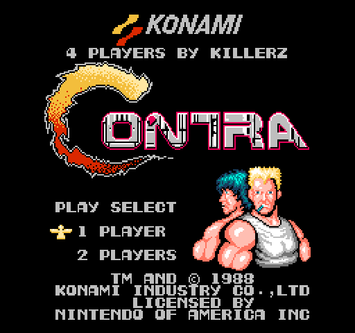
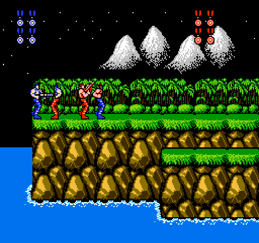
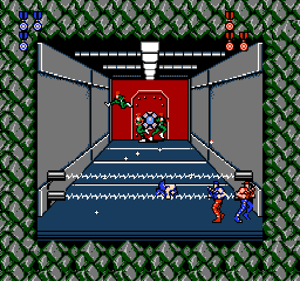
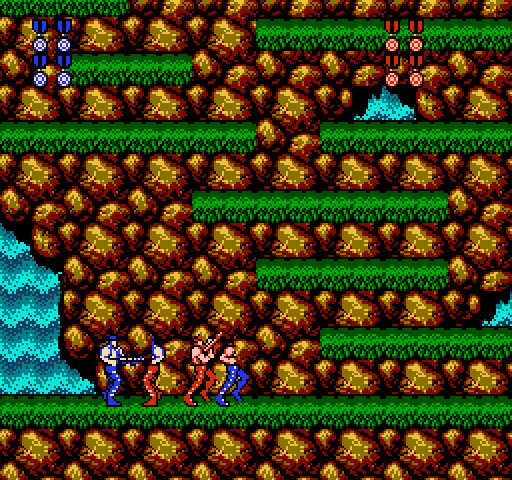

# CONTRA — 4 PLAYERS (by Killerz)

**The NES classic, now for four.** Grab three friends, plug in a Four Score and storm Red Falcon's
base together: four commandos, four guns, one jungle that never saw it coming.

> 🇪🇸 [Versión en español más abajo](#español)

[**⬇ Download the patch (latest release)**](../../releases/latest) · ⭐ *If you enjoy it, leave a star, it really helps!*

| Jungle | Base | Waterfall |
|---|---|---|
|  |  |  |

## The game

In 1988 Bill and Lance were sent alone to stop the alien army of Red Falcon. This time they bring
backup. **Contra — 4 Players** is the original Contra (NES, USA) with room for **up to four players
at the same time**, using the NES Four Score adapter:

- **1, 2, 3 or 4 players** — pick your squad on the title screen (press SELECT to scroll the list).
- **Four commandos on screen, each with their own look**: the classic blue and red soldiers, an
  all-blue trooper and a blue-and-red one, so nobody loses track of who is who.
- **Every player fights for real**: own lives, own weapon, own score and extra lives, own place
  on the HUD.
- **Teamwork matters**: the screen only scrolls when nobody is left behind, enemies aim at the
  closest commando, and bosses pick their target among everyone still standing.
- **Out of lives?** Press **A** to borrow a life from a teammate and jump right back in.
- **The legendary Konami code** (↑ ↑ ↓ ↓ ← → ← → B A on the title screen) gives **30 lives to
  every player**.
- **The attract demo** shows the full four-player squad in action.
- With 1 or 2 players it plays exactly like the original game.

## How to play

1. Download `Contra4P-by-Killerz.ips` from the [latest release](../../releases/latest).
2. Apply it to your own **Contra (USA)** NES ROM with any IPS patcher, for example
   [Rom Patcher JS](https://www.marcrobledo.com/RomPatcher.js/) (works in the browser) or Floating IPS.
   - Expected ROM: Contra (USA), CRC32 `F6035030` (without the 16-byte header).
   - Works with iNES and NES 2.0 headers.
3. Open the patched ROM in an emulator with **Four Score** support and enable it (see the table below).
4. On the title screen press **SELECT** until you see **4 PLAYERS** and press **START**.

### Setting up 4 players in each emulator

The hack is not in the emulators' game databases, so **auto-detection will not turn the Four Score
on: select it by hand**. Players 3 and 4 can use extra gamepads (Xbox, PlayStation, generic USB)
or two parts of the keyboard.

| Emulator | How to enable 4 players |
|---|---|
| **FCEUX** (Windows/Linux) | *Config → Input*: tick **Attach four-score**, keep *Port 1* and *Port 2* on **Gamepad**, then press *Configure* on gamepads 1-4. |
| **Mesen 2** (Windows/Linux/macOS) | *Settings → Input → NES*: set the controller setup to the **Four Score** (four player adapter) and map players 1-4. |
| **Nestopia UE** | In the input settings choose the **NES Four Score** adapter (not "Famicom 4-player") and map controllers 1-4. |
| **puNES** | *Settings → Input*: set the controllers mode to **Four Score** and configure ports 1-4. |
| **RetroArch** (PC, Android, consoles) | Use the **Mesen**, **Nestopia** or **FCEUmm** core (*QuickNES does not support 4 players*). In *Quick Menu → Core Options* turn on the 4-player / Four Score adapter (Nestopia: *4 Player Adapter → NTSC*), then in *Settings → Input* assign *Port 1-4 Controls*. |

On real hardware the hack follows the original Four Score protocol (switch on **4**), but it has
only been tested in emulators.

Controls are the original ones: **B** fires, **A** jumps, **START** (player 1) pauses.

Without a Four Score the game still works as the classic 1-2 player Contra.

## Credits

- **Hack: Killerz**
- Built on the excellent annotated disassembly of Contra by
  [vermiceli/nes-contra-us](https://github.com/vermiceli/nes-contra-us), which this repository
  is forked from (its original documentation lives in [README-disassembly.md](README-disassembly.md)).
- Contra © Konami. This is a free, non-commercial fan project, not affiliated with or endorsed by
  Konami. **No ROM is included**: you need your own legally obtained copy of the game.

## Build from source

Install [cc65](https://cc65.github.io/), put your Contra (USA) ROM as `baserom.nes` in the project
root and run `build.ps1` (Windows) or `build.sh`. Technical notes about the hack are in
[HACK-4P.md](HACK-4P.md).

---

## Español

**El clásico de NES, ahora para cuatro.** Junta a tres amigos, conecta un Four Score y asaltad juntos
la base de Red Falcon: cuatro comandos, cuatro armas y una jungla que no los vio venir.

[**⬇ Descargar el parche (última versión)**](../../releases/latest) · ⭐ *¡Si te gusta, deja una estrella!*

### El juego

En 1988 Bill y Lance fueron enviados solos contra el ejército alienígena de Red Falcon. Esta vez
traen refuerzos. **Contra — 4 Players** es el Contra original (NES, USA) con sitio para **hasta
cuatro jugadores a la vez**, usando el adaptador Four Score de NES:

- **1, 2, 3 o 4 jugadores**: elige tu escuadrón en la pantalla de título (SELECT desplaza la lista).
- **Cuatro comandos en pantalla, cada uno con su aspecto**: los clásicos soldados azul y rojo, uno
  todo azul y otro azul y rojo, para que nadie se pierda.
- **Cada jugador cuenta**: sus propias vidas, arma, puntuación y vidas extra, y su sitio en el HUD.
- **El trabajo en equipo importa**: la pantalla solo avanza si nadie se queda atrás, los enemigos
  apuntan al comando más cercano y los jefes eligen objetivo entre los que siguen en pie.
- **¿Sin vidas?** Pulsa **A** para pedir una vida prestada a un compañero y volver a la acción.
- **El mítico código Konami** (↑ ↑ ↓ ↓ ← → ← → B A en el título) da **30 vidas a todos los jugadores**.
- **La demo** del título muestra al escuadrón completo de cuatro en acción.
- Con 1 o 2 jugadores se juega exactamente igual que el original.

### Cómo jugar

1. Descarga `Contra4P-by-Killerz.ips` de la [última versión](../../releases/latest).
2. Aplícalo a tu propia ROM de **Contra (USA)** con cualquier parcheador IPS, por ejemplo
   [Rom Patcher JS](https://www.marcrobledo.com/RomPatcher.js/) (funciona en el navegador) o Floating IPS.
   - ROM esperada: Contra (USA), CRC32 `F6035030` (sin la cabecera de 16 bytes).
   - Funciona con cabecera iNES y NES 2.0.
3. Abre la ROM parcheada en un emulador con soporte de **Four Score** y actívalo (ver la tabla).
4. En el título pulsa **SELECT** hasta ver **4 PLAYERS** y pulsa **START**.

#### Configurar 4 jugadores en cada emulador

El hack no está en las bases de datos de los emuladores, así que **la detección automática no
activa el Four Score: elígelo a mano**. Los jugadores 3 y 4 pueden usar mandos extra (Xbox,
PlayStation, USB genéricos) o dos zonas del teclado.

| Emulador | Cómo activar 4 jugadores |
|---|---|
| **FCEUX** (Windows/Linux) | *Config → Input*: marca **Attach four-score**, deja *Port 1* y *Port 2* en **Gamepad** y pulsa *Configure* en los mandos 1-4. |
| **Mesen 2** (Windows/Linux/macOS) | *Settings → Input → NES*: elige el adaptador **Four Score** (four player adapter) y asigna los jugadores 1-4. |
| **Nestopia UE** | En la configuración de controles elige el adaptador **NES Four Score** (no "Famicom 4-player") y asigna los mandos 1-4. |
| **puNES** | *Settings → Input*: pon el modo de mandos en **Four Score** y configura los puertos 1-4. |
| **RetroArch** (PC, Android, consolas) | Usa el núcleo **Mesen**, **Nestopia** o **FCEUmm** (*QuickNES no admite 4 jugadores*). En *Quick Menu → Core Options* activa el adaptador de 4 jugadores / Four Score (Nestopia: *4 Player Adapter → NTSC*) y en *Settings → Input* asigna *Port 1-4 Controls*. |

En una NES real el hack sigue el protocolo del Four Score original (interruptor en **4**), pero solo
se ha probado en emuladores.

Controles originales: **B** dispara, **A** salta y **START** (jugador 1) pausa.

Sin Four Score el juego funciona como el Contra clásico de 1-2 jugadores.

### Créditos

- **Hack: Killerz**
- Basado en el magnífico desensamblado comentado de Contra de
  [vermiceli/nes-contra-us](https://github.com/vermiceli/nes-contra-us), del que este repositorio
  es un fork.
- Contra © Konami. Proyecto fan gratuito y sin ánimo de lucro, sin relación con Konami.
  **No incluye la ROM**: necesitas tu propia copia legal del juego.
